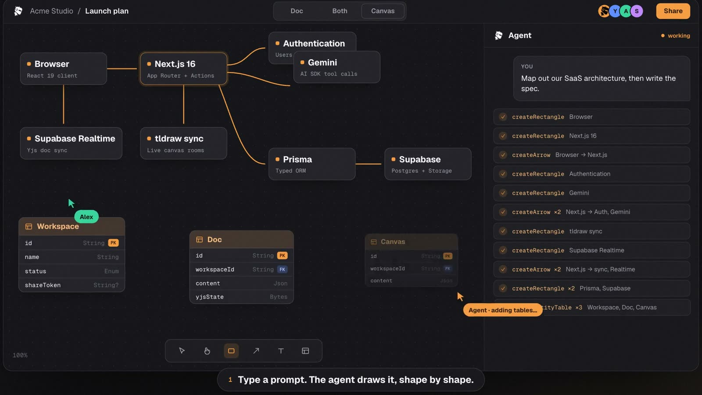

# Outpost

Outpost is an agentic workspace. An AI agent draws on an infinite canvas and writes in a shared document alongside you and your team.

Each workspace is one document and one canvas. Describe what you are building from the dashboard, and the agent drafts both surfaces in the same room.

## Features

- **Landing page** with product sections, a short walkthrough, and Clerk pricing.
- **Accounts and teams** through Clerk. Sign in, sign up, and switch between a personal account and an organization.
- **Dashboard prompt** that creates a workspace from a description and opens the agent with that prompt. Voice dictation is available in browsers that support the Web Speech API (Chrome, Edge, and Safari).
- **Workspace board** with four columns: Planning, In progress, In review, and Done. Cards can be dragged to change status and order.
- **Split editor** with Doc, Canvas, and Both views.
- **Document** built with BlockNote. Content is stored as block JSON, and live edits sync through Yjs over Supabase Realtime.
- **Canvas** built with tldraw, including rectangles, ellipses, text, arrows, and entity-relationship tables. Collaborator names and cursors come from the signed-in Clerk user.
- **Workspace agent** powered by Google Gemini. It edits the open canvas and document through tools (shapes, entity tables, and Markdown blocks) and streams its reply, including reasoning.
- **Public read-only links** at `/shared/[token]` when the workspace owner’s plan includes public sharing.
- **PDF export** of the document and the canvas when the workspace owner’s plan includes PDF export.
- **Usage limits.** The free plan allows 3 workspaces and 20 agent prompts per month. Paid allowances come from Clerk Billing.

## Screenshot

Workspace preview used on the landing page:



The same preview is also available as video at `public/videos/hero.mp4` and `public/videos/hero.webm`.

## Tech stack

| Area | Choice |
| --- | --- |
| App | [Next.js](https://nextjs.org) 16 (App Router), React 19, TypeScript |
| Styling | Tailwind CSS 4, shadcn/ui, Lucide |
| Auth and billing | [Clerk](https://clerk.com) (`@clerk/nextjs`), including organizations |
| Database | PostgreSQL with [Prisma ORM](https://www.prisma.io) 8 (`@prisma/orm-postgres`) |
| Document collaboration | [BlockNote](https://www.blocknotejs.org), [Yjs](https://yjs.dev), [Supabase Realtime](https://supabase.com/docs/guides/realtime) |
| Canvas | [tldraw](https://tldraw.dev) and `@tldraw/sync` |
| Agent | [Vercel AI SDK](https://ai-sdk.dev) with `@ai-sdk/google` (`gemini-3.5-flash-lite`) |
| Hosting | [Vercel](https://vercel.com) |
| Validation | Zod |

## Project structure

```text
app/
  page.tsx                 Landing page
  (auth)/                  Sign-in and sign-up
  (main)/dashboard/        Prompt and recent workspaces
  (main)/workspaces/       Kanban board
  (main)/workspace/[id]/   Doc, canvas, share dialog, and agent panel
  shared/[token]/          Read-only shared workspace
  api/agent/route.ts       Streaming agent endpoint
actions/                   Server Actions for workspaces, docs, and canvas
components/                App shell, editors, entity tables, and UI
hooks/                     Collaborative doc and agent chat
lib/                       Database client, billing, access, and agent tools
prisma/schema.prisma       Data model
prisma.config.ts           Prisma CLI config (loads .env)
migrations/                On-disk Prisma migrations
src/prisma/                Generated database contract
public/                    Brand assets, icons, and the landing video
proxy.ts                   Clerk protection for app routes
```

## Prerequisites

- **Node.js 22.18 or newer** on the machine where you install dependencies and run migrations. Next.js 16 requires Node.js 20.9 or newer. The Prisma CLI requires Node.js 22.18, 24.11, or 26 and above.
- **npm** (this repo includes `package-lock.json`).
- A **PostgreSQL** database.
- A **Clerk** application with the API keys below.
- A **Google Generative AI** API key, so the workspace agent can call Gemini.
- A **Supabase** project if you want live document collaboration. The document still opens from its saved state when Supabase is unset.
- A **Vercel** account, connected to the Git host that has this repository, for the deployed app.

## Installation

```bash
npm install
```

`npm install` runs `prisma skills sync` afterward. That command refreshes Prisma’s local agent skill files and can fail without stopping the install.

## Environment setup

Locally, put these in a `.env` file in the project root. Environment files matching `.env*` are gitignored.

On Vercel, add the same names under **Project → Settings → Environment Variables**. Use the Production environment for the live site. Add them to Preview as well when a preview deployment should sign in, reach the database, and call the agent. `NEXT_PUBLIC_*` values are copied into the browser bundle during `next build`, so change one of them and then redeploy.

```bash
# Clerk (Dashboard → API keys)
NEXT_PUBLIC_CLERK_PUBLISHABLE_KEY=
CLERK_SECRET_KEY=

# App database connection (transaction pooler is fine)
DATABASE_URL=

# Direct Postgres connection used by the Prisma CLI when set
DIRECT_URL=

# Supabase (Project Settings → API). Used for live document sync.
NEXT_PUBLIC_SUPABASE_URL=
NEXT_PUBLIC_SUPABASE_PUBLISHABLE_KEY=

# Google AI (read by @ai-sdk/google)
GOOGLE_GENERATIVE_AI_API_KEY=

# Optional. Your own tldraw sync server, for example a Cloudflare Worker.
# Leave unset to use tldraw's public demo sync server. Demo rooms are public and can be wiped.
NEXT_PUBLIC_TLDRAW_SYNC_URL=

# Optional tldraw license key passed to the canvas.
NEXT_PUBLIC_TLDRAW_LICENSE_KEY=
```

| Variable | Required | Purpose |
| --- | --- | --- |
| `NEXT_PUBLIC_CLERK_PUBLISHABLE_KEY` | Yes | Clerk client key |
| `CLERK_SECRET_KEY` | Yes | Clerk server key |
| `DATABASE_URL` | Yes | PostgreSQL URL used by the app (`lib/prisma.ts`) |
| `DIRECT_URL` | For migrations | Connection the Prisma CLI prefers. Falls back to `DATABASE_URL` |
| `NEXT_PUBLIC_SUPABASE_URL` | For live docs | Supabase project URL |
| `NEXT_PUBLIC_SUPABASE_PUBLISHABLE_KEY` | For live docs | Supabase publishable key. Broadcast-only; no user session is started |
| `GOOGLE_GENERATIVE_AI_API_KEY` | For the agent | Gemini API key used by `@ai-sdk/google` |
| `NEXT_PUBLIC_TLDRAW_SYNC_URL` | No | Canvas room server. The client connects to `{URL}/connect/{roomId}` |
| `NEXT_PUBLIC_TLDRAW_LICENSE_KEY` | No | tldraw license passed into the editor |

When Postgres is hosted on Supabase, use the transaction-mode pooler URL for `DATABASE_URL` and the session-mode pooler URL for `DIRECT_URL`. Migrations need the direct connection.

### Clerk Billing feature slugs

Paid behavior is read from the workspace owner’s Clerk subscription. These slugs are the ones the app checks:

| Slug | Effect |
| --- | --- |
| `agents_prompt_500` | 500 agent prompts per member, per month |
| `agents_prompts_2000` | 2,000 agent prompts per member, per month |
| `unlimited_workspaces` | Removes the 3-workspace free limit |
| `public_share_links` | Allows read-only share links |
| `pdf_export` | Allows PDF export of the doc and canvas |

Prompt features are checked in the order `agents_prompts_2000`, then `agents_prompt_500`. With no active subscription, the owner stays on the free plan: 3 workspaces and 20 prompts per calendar month (UTC).

Organizations use Clerk roles. Any member of the workspace’s organization can open and edit it. Deleting a workspace is limited to its creator or an `org:admin` of that organization.

## Database

The schema lives in `prisma/schema.prisma`. Models:

| Model | Role |
| --- | --- |
| `User` | Local profile keyed by `clerkId` |
| `Workspace` | Name, description, kanban status, position, optional `clerkOrgId`, optional `shareToken` |
| `Doc` | BlockNote JSON plus Yjs state for one workspace |
| `Canvas` | tldraw snapshot for one workspace |
| `AgentPrompt` | One row per counted agent prompt, kept even if the workspace is deleted |

Apply the migrations in `migrations/` against the database named by `DIRECT_URL` (or `DATABASE_URL`):

```bash
npx prisma db migrate
```

Preview the route without changing the database:

```bash
npx prisma db migrate --show
```

`prisma.config.ts` loads `.env` and points the CLI at `DIRECT_URL`, then `DATABASE_URL`.

Run this from your machine before the first Vercel deploy, against the same database `DATABASE_URL` will use in production. The Vercel build runs `next build` only. It does not apply migrations.

`DIRECT_URL` is for that CLI command. The deployed app reads `DATABASE_URL`.

## Running locally

```bash
npm run dev
```

Open [http://localhost:3000](http://localhost:3000).

| Script | What it does |
| --- | --- |
| `npm run dev` | Start the Next.js development server |
| `npm run build` | Production build (`next build`), the same command Vercel runs |
| `npm start` | Serve that build on your machine. Vercel starts the app itself |
| `npm run lint` | Run ESLint |

Protected routes (`/dashboard`, `/workspace`, `/workspaces`) redirect to sign-in when there is no Clerk session. `/` and `/shared/[token]` stay public. Shared links return a 404 when sharing is off or the owner’s plan does not include `public_share_links`.

## Deploy on Vercel

There is no `vercel.json`. Vercel detects Next.js from `package.json` and `next.config.ts`.

1. Push the repository to GitHub, GitLab, or Bitbucket. Leave `.env` uncommitted.
2. In Vercel, choose **Add New… → Project** and import that repository.
3. Keep the detected settings:
   - Framework preset: **Next.js**
   - Install command: `npm install`
   - Build command: `npm run build`
   - Root directory: the repository root
4. Set the Node.js version to **22.x** (Project → Settings → General). Next.js 16 needs Node.js 20.9 or newer, and 22.x matches the Prisma CLI used when dependencies install.
5. Add the environment variables from [Environment setup](#environment-setup) for Production.
6. Deploy.

`npm install` on Vercel also runs `prisma skills sync || exit 0`. That only refreshes Prisma’s agent skill files. Apply the database migrations yourself with `npx prisma db migrate` before the site goes live.

After the deployment finishes, open the `*.vercel.app` URL Vercel prints (or your custom domain). In the Clerk application, allow that hostname so `/sign-in` and `/sign-up` match the deployed origin. This app loads Clerk’s frontend from `/__clerk` (`proxyUrl` in `app/layout.tsx`, `frontendApiProxy` in `proxy.ts`).

`next.config.ts` already allows user images from `img.clerk.com`. Canvas sync still follows `NEXT_PUBLIC_TLDRAW_SYNC_URL`. When that variable is empty on Vercel, the canvas uses tldraw’s public demo server. Demo rooms are public and can be wiped.

A later push to the connected branch deploys again with the same settings. Preview deployments use the Preview environment variables.

## Routes

| Path | Who can open it | What it is |
| --- | --- | --- |
| `/` | Anyone | Landing page |
| `/sign-in`, `/sign-up` | Anyone | Clerk authentication |
| `/dashboard` | Signed-in | Prompt box and recent workspaces |
| `/workspaces` | Signed-in | Kanban board for the active organization, or personal workspaces |
| `/workspace/[id]` | Members of that workspace | Editor. `?view=doc`, `?view=canvas`, or `?view=both` (default). `?prompt=` sends the first agent message |
| `/shared/[token]` | Anyone with the link | Read-only doc and canvas from the saved database copies |

## API

Workspace, document, and canvas changes go through Server Actions in `actions/`. The only Route Handler is the agent.

### `POST /api/agent`

Requires a signed-in Clerk user who can access the workspace. The model reply is a UI message stream. Tool calls are defined on the server and executed in the browser against the open editors.

**Request body**

```json
{
  "messages": [],
  "workspaceId": "workspace id",
  "canvasContext": "text summary of the canvas, or null if that view is closed",
  "docContext": "text summary of the document, or null if that view is closed"
}
```

`messages` is an AI SDK `UIMessage` array. A prompt is counted only when the last message is from the user. Automatic follow-ups after tool calls are not counted again.

**Responses**

| Status | Body | When |
| --- | --- | --- |
| 200 | UI message stream | Gemini accepted the request. The prompt is recorded after the model finishes |
| 401 | `Unauthorized` | No signed-in user |
| 404 | `Workspace not found` | The caller cannot access that workspace |
| 404 | `{ "error": "Workspace owner not found" }` | The workspace has no owner to bill |
| 402 | `{ "error": "prompt_limit_reached", "used": 20, "limit": 20 }` | The owner is out of prompts for this month |

**Canvas tools:** `createRectangle`, `createEllipse`, `createText`, `createArrow`, `updateShape`, `deleteShape`, `createEntityTable`, `addColumn`, `updateColumn`, `removeColumn`, `connectRelationship`.

**Document tools:** `insertDocContent`, `updateDocBlock`, `deleteDocBlocks`, `replaceDoc`. Document content is Markdown.

## License

No license file is included in this repository. `package.json` marks the project as private.
